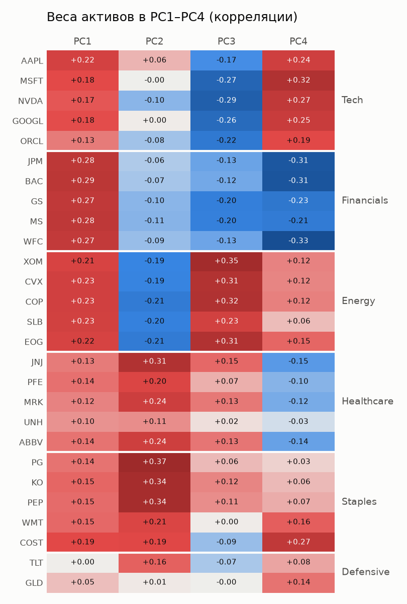
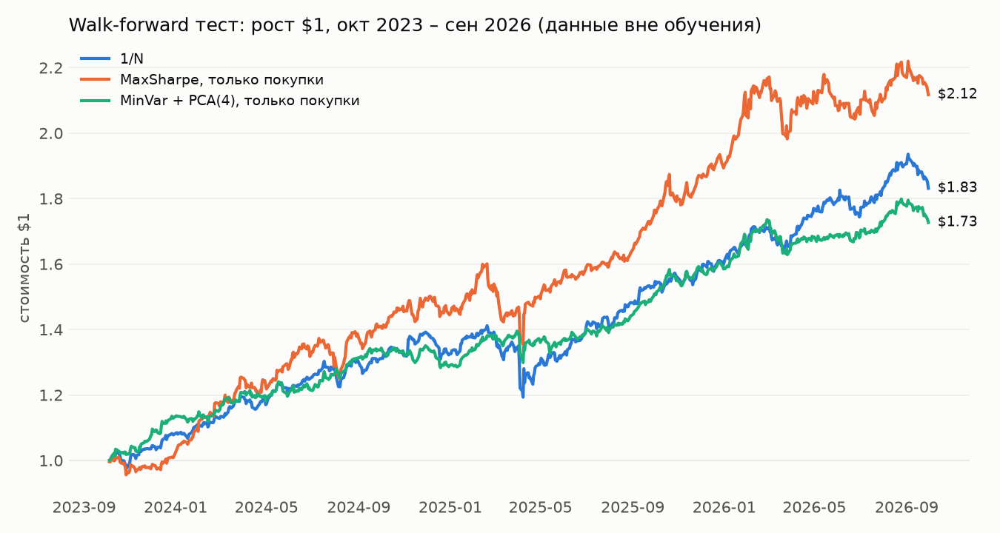

# pca-lab: линейная алгебра в анализе портфеля

Учебный проект: как ковариационная матрица, спектральное разложение и квадратичные формы
работают в реальной задаче — анализе и оптимизации портфеля из 27 активов (25 акций США из 5 секторов,
облигации TLT и золото GLD) на дневных данных за октябрь 2021 – сентябрь 2026.

## Главное

1. **Риск оценивается намного лучше доходности.** На данных вне обучения портфель минимального риска
   держал риск 8.8% при прогнозе 8.6%. Ошибка оценки доходности за два года (19% годовых) равна типичной
   величине самой доходности.
2. **Самая сложная модель проиграла самой простой.** MaxSharpe без ограничений — лучший задним числом
   (Sharpe 2.66) и худший вне обучения (0.36 при 1.80 у равных весов).
3. **Надёжно доказано только снижение риска.** Преимущества стратегий по Sharpe над равными весами
   на трёх годах теста неотличимы от шума.

## Этапы

| # | Этап | Линейная алгебра | Ноутбук |
|---|------|------------------|---------|
| 1 | Цены и доходности | матрица данных R (T × N), линейность r_p = wᵀr | [01_returns](notebooks/01_returns.ipynb) |
| 2 | Ковариационная матрица | Σ = XᵀX/(T−1), положительная полуопределённость, обусловленность | [02_covariance](notebooks/02_covariance.ipynb) |
| 3 | PCA | Σ = QΛQᵀ, собственные векторы как факторы, связь с SVD | [03_pca](notebooks/03_pca.ipynb) |
| 4 | Риск портфеля | квадратичная форма √(wᵀΣw), разложение риска | [04_portfolio_risk](notebooks/04_portfolio_risk.ipynb) |
| 5 | Оптимизация | лагранжиан, Σ⁻¹, shrinkage, walk-forward | [05_optimization](notebooks/05_optimization.ipynb) |

Вывод формул через касание линии уровня и ограничения: [метод множителей Лагранжа](docs/lagrange_multipliers.md).
Одна и та же идея даёт и PCA ($\Sigma v = \lambda v$), и портфель минимального риска ($w \propto \Sigma^{-1}\mathbf 1$).

## Результаты

### Структура рынка

- Средняя корреляция внутри сектора — 0.54, между секторами — 0.15.
- PCA на корреляционной матрице: PC1 «рынок» объясняет 26% дисперсии. PC2–PC4 — длинно-короткие факторы
  «защитные против нефти», «нефть против технологий», «технологии против банков».
- Слепой тест: по весам в PC2–PC5 без названий активов k-means восстанавливает все 6 групп (27 из 27 активов).
  Число групп при этом задано заранее.



### Откуда берётся риск

- Формула √(wᵀΣw) совпадает с волатильностью реального ряда портфеля.
- В портфеле из 27 активов с равными весами 90% риска приходится на один фактор — рынок (PC1).
- «Маленький» для рынка фактор может быть крупным для портфеля: PC18 объясняет 0.9% дисперсии рынка,
  но 12.8% риска портфеля 60/40. Поэтому отбрасывать младшие компоненты без проверки нельзя.

### Оптимизация вне обучения

Каждый месяц веса считаются только по прошлым 504 дням и держатся следующие 21 день.
Тест: 5 октября 2023 – 30 сентября 2026, 36 пересчётов, издержки не учтены.

| Стратегия | Итог $1 | Риск, факт | Риск, прогноз | Sharpe | Худшая просадка | Оборот в год |
|---|---|---|---|---|---|---|
| Равные веса (1/N) | 1.83 | 11.7% | 13.0% | 1.80 | −15.5% | не учтён |
| MinVar, только покупки | 1.64 | 8.8% | 8.6% | 1.94 | −7.1% | 0.75 |
| MinVar + PCA(4), только покупки | 1.73 | 8.9% | 8.8% | 2.12 | −6.9% | 0.74 |
| MaxSharpe, только покупки | 2.12 | 14.0% | 12.7% | 1.88 | −15.4% | 1.85 |
| MaxSharpe с риском 10% | 1.51 | 13.5% | 10.0% | 1.10 | −13.1% | 4.73 |
| MaxSharpe без ограничений | 1.07 | 60.3% | 34.8% | 0.36 | −77.5% | 21.88 |



**Что отличимо от шума** (блочный бутстрэп по 21 дню, 95% интервал разности):

| Сравнение | Разность | 95% интервал | Отличимо от нуля |
|---|---|---|---|
| Риск: MinVar, только покупки − 1/N | −3.0 п.п. | от −5.0 до −1.3 | да |
| Sharpe: MaxSharpe, только покупки − 1/N | +0.08 | от −1.05 до +1.03 | нет |
| Sharpe: MinVar + PCA(4), только покупки − 1/N | +0.32 | от −0.84 до +1.19 | нет |
| Sharpe: MinVar + PCA(4) − MinVar, оба только покупки | +0.17 | от −0.06 до +0.34 | нет |

### Почему MaxSharpe без ограничений провалился

Подмена входных оценок настоящими данными следующих двух лет (намеренный взгляд в будущее, только для диагностики,
12 пересчётов, прогнозный риск везде 10%):

| Доходность μ | Ковариация Σ | Sharpe |
|---|---|---|
| прошлая | прошлая | 1.00 |
| прошлая | будущая | 0.25 |
| будущая | прошлая | 5.18 |
| не используется (MinVar) | прошлая | 3.10 |

Причин две:

- **Прогноз доходности выбирает неверные ставки.** Идеальная ковариация не помогает, идеальная доходность даёт скачок.
  Связь оценки за два года со следующими двумя годами: 0.83 у ковариаций и только 0.24 у средних доходностей.
- **Деление на сумму раздувает позиции.** В формуле w = x / 1ᵀx знаменатель бывает мал: в ноябре 2023 сумма упала
  с обычных 19.6 до 1.78, позиции достигли 35 долларов на доллар капитала, и портфель потерял 61% за месяц.

### Длина истории

Те же месяцы теста, меняется только история для расчёта весов:

| История | Ошибка годовой μ | MaxSharpe с риском 10%: Sharpe | MinVar: Sharpe | MinVar: факт / прогноз риска |
|---|---|---|---|---|
| 2 года | ±17.6% | 1.10 | 1.82 | 1.06 |
| 1 год | ±24.2% | 0.91 | 1.72 | 1.20 |
| 6 месяцев | ±32.0% | 0.19 | 1.76 | 1.36 |

Для средней доходности важна длина истории в годах, а для ковариации — число наблюдений.
Поэтому короткая история сильнее всего бьёт по стратегиям, которые опираются на прогноз доходности.

## Допущения

- Простые дневные доходности для Σ, PCA и портфелей, лог-доходности только для накопления во времени.
- Цены скорректированы на сплиты и дивиденды. Короткие пропуски заполняются последней известной ценой, а не интерполяцией.
- Безрисковая ставка в Sharpe равна нулю. При ненулевой ставке все Sharpe были бы ниже.
- Внутри месяца веса фиксированы, то есть портфель ежедневно возвращается к целевым весам.
- Торговых издержек нет, короткие продажи и заём бесплатны, остаток капитала не приносит дохода.

## Ограничения и риск переобучения

- **Отбор активов задним числом.** Список составлен из компаний, известных сегодня, поэтому результаты завышены.
  Без NVDA MaxSharpe с запретом коротких продаж уступает равным весам (Sharpe 1.60 против 1.67).
- **Удачный период.** Sharpe 1.80 у равных весов отражает рост рынка за эти три года, а не норму.
  Числа подходят для сравнения стратегий, но не как оценка будущего заработка.
- **Множественные сравнения.** На одном периоде сравнивались 10 стратегий, поэтому лучший результат отчасти объясняется удачей.
  MinVar + PCA(4) лидирует, но выбран среди вариантов на тех же данных.
- **Издержки занижены.** При 10 б.п. за сделку MaxSharpe без ограничений терял бы около 4.4% годовых только на ежемесячных
  пересчётах, MinVar с запретом коротких продаж — около 0.15%. Ежедневная подстройка весов внутри месяца не учтена.
- **Нестабильность оценок.** Корреляции между двумя половинами периода меняются в среднем на 0.13, максимум на 0.47.
  Факторы с близкими собственными значениями (PC2 и PC3) на другом периоде могут смешаться.
- **Что не проверялось.** Шаг пересчёта 21 день на устойчивость не проверялся. Отдельной отложенной выборки нет:
  тестовый период использовался и для сравнения вариантов.

## Структура

```
src/
  data.py     — загрузка цен (yfinance, локальный кэш), доходности
  risk.py     — ковариация, корреляция, разложение риска, shrinkage, PCA-фильтрация
  pca.py      — спектральное разложение, доли дисперсии, ряды факторов
  optimize.py — min variance, max Sharpe, граница эффективности
  backtest.py — walk-forward тест, метрики, бутстрэп разностей
  plots.py    — графики
notebooks/    — по ноутбуку на этап, с выводами и формулами
docs/         — разборы математики
reports/figures/ — сохранённые графики
```

## Запуск

```bash
python -m venv .venv
.venv/bin/pip install -r requirements.txt
.venv/bin/jupyter lab
```

При первом запуске цены скачиваются с Yahoo Finance и кэшируются в `data/prices.csv` (в репозиторий не входят).
Yahoo со временем пересчитывает скорректированные цены, поэтому свежая загрузка может дать немного другие числа.
