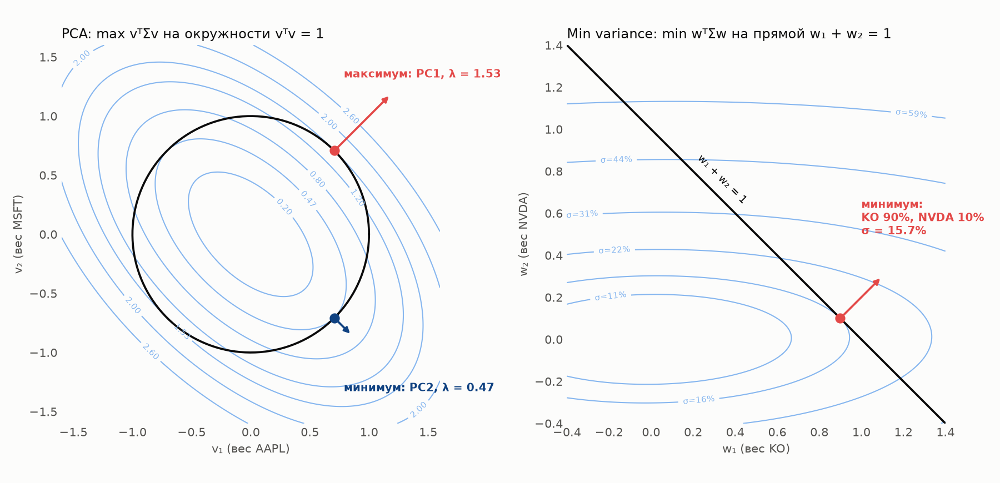

# Метод множителей Лагранжа: PCA и портфель минимального риска

В проекте одна и та же квадратичная форма $w^\top\Sigma w$ оптимизируется дважды:

- **PCA** (этап 3) — *максимум* $v^\top\Sigma v$: направление, вдоль которого активы колеблются сильнее всего;
- **Min variance** (этап 5) — *минимум* $w^\top\Sigma w$: портфель с наименьшим риском.

Обе задачи решаются одним приёмом — методом множителей Лагранжа. Разница только в ограничении, и именно оно определяет ответ.

## Зачем нужно ограничение

Без ограничений обе задачи вырождаются:

- $\max v^\top\Sigma v$ — достаточно умножить $v$ на 10, 100, 1000: дисперсия растёт до бесконечности;
- $\min w^\top\Sigma w$ — достаточно взять $w = 0$ (ничего не вкладывать): риск нулевой.

Ограничение задаёт множество допустимых точек:

| Задача | Ограничение | Допустимые точки (2 актива) |
|---|---|---|
| PCA | $v^\top v = 1$ — ищем направление, а не масштаб | окружность |
| Min variance | $\mathbf 1^\top w = 1$ — распределяем ровно 100% капитала | прямая $w_1 + w_2 = 1$ |

## Идея метода: касание

Аналогия: тропа на склоне горы. Самая высокая точка *тропы* (не горы) — там, где тропа идёт **вдоль** линии высоты, касаясь её. Пока тропа пересекает линии высоты, по ней можно подняться ещё выше.

На языке векторов: **градиент** функции $\nabla f$ — направление её быстрейшего роста — перпендикулярен линии уровня. В точке касания он перпендикулярен и ограничению, то есть параллелен градиенту ограничения $\nabla g$:

$$\nabla f = \lambda\,\nabla g$$

Коэффициент $\lambda$ и есть **множитель Лагранжа**. Формально то же условие получают, приравнивая к нулю производные лагранжиана $\mathcal L = f - \lambda\,(g - c)$: по переменным — условие касания, по $\lambda$ — само ограничение.



*Голубые линии — линии уровня $w^\top\Sigma w$ (одинаковая дисперсия вдоль линии), а не облако данных. Чёрная линия — ограничение. Точки — касания, стрелки — градиент $2\Sigma w$, перпендикулярный ограничению.*

## Градиенты

Для $\Sigma = \begin{pmatrix} a & b \\ b & c\end{pmatrix}$:

$$f(v) = v^\top\Sigma v = a v_1^2 + 2b\,v_1 v_2 + c\,v_2^2, \qquad
\frac{\partial f}{\partial v_1} = 2a v_1 + 2b v_2, \quad \frac{\partial f}{\partial v_2} = 2b v_1 + 2c v_2$$

То есть $\nabla(v^\top\Sigma v) = 2\Sigma v$ — матричный аналог $(x^2)' = 2x$. Для ограничений: $\nabla(v^\top v) = 2v$, $\nabla(\mathbf 1^\top w) = \mathbf 1$.

## PCA: из касания получается уравнение собственного вектора

$$2\Sigma v = \lambda\cdot 2v \quad\Longrightarrow\quad \Sigma v = \lambda v$$

Умножив слева на $v^\top$: $v^\top\Sigma v = \lambda\,v^\top v = \lambda$. Множитель Лагранжа равен дисперсии вдоль найденного направления — поэтому собственные значения и обозначают $\lambda$.

Метод находит все точки касания: максимум ($\lambda_1$, PC1) и минимум ($\lambda_2$, PC2); для 27 активов — все 27 собственных векторов.

**Пример (левая панель):** AAPL и MSFT, корреляция 0.53.

$$\begin{pmatrix}1 & 0.53\\ 0.53 & 1\end{pmatrix}\begin{pmatrix}0.71\\0.71\end{pmatrix} = \begin{pmatrix}1.09\\1.09\end{pmatrix} = 1.53\cdot\begin{pmatrix}0.71\\0.71\end{pmatrix}$$

PC1 $= (0.71, 0.71)$ — «обе акции вместе», $\lambda_1 = 1.53$; PC2 $= (0.71, -0.71)$ — «одна против другой», $\lambda_2 = 0.47$.

В коде ([`src/pca.py`](../src/pca.py)) уравнение $\Sigma v = \lambda v$ решается напрямую через `np.linalg.eigh`; метод Лагранжа объясняет, *почему* собственные векторы — это направления максимальной дисперсии.

## Min variance: из касания получается равенство предельных рисков

$$2\Sigma w = \gamma\,\mathbf 1 \quad\Longrightarrow\quad w = \frac{\gamma}{2}\Sigma^{-1}\mathbf 1, \qquad
\mathbf 1^\top w = 1 \;\Rightarrow\; w = \frac{\Sigma^{-1}\mathbf 1}{\mathbf 1^\top\Sigma^{-1}\mathbf 1}$$

Смысл условия $\Sigma w = \frac{\gamma}{2}\mathbf 1$: все компоненты $(\Sigma w)_i$ равны. Поскольку $(\Sigma w)_i/\sigma_p$ — **предельный риск** актива $i$ (этап 4), в оптимуме **предельные риски всех активов одинаковы**. Иначе можно было бы переложить капитал из актива с большим предельным риском в актив с меньшим и снизить риск портфеля.

**Пример (правая панель):** KO ($\sigma$ = 16.7%) и NVDA ($\sigma$ = 52.0%), годовая ковариационная матрица

$$\Sigma = \begin{pmatrix} 0.0278 & -0.0026 \\ -0.0026 & 0.2703\end{pmatrix}, \qquad w^* = (0.90,\ 0.10), \qquad \Sigma w^* = (0.0247,\ 0.0247)$$

Компоненты $\Sigma w^*$ равны — условие выполнено. Риск портфеля 15.7% ниже, чем у KO в одиночку, за счёт слабо отрицательной ковариации.

В коде ([`src/optimize.py`](../src/optimize.py)) $\Sigma^{-1}\mathbf 1$ вычисляется как решение системы `np.linalg.solve(Σ, 1)`, а не через явную обратную матрицу: так меньше операций и меньше накопление ошибок округления при плохой обусловленности $\Sigma$.

## Сравнение

| | PCA | Min variance |
|---|---|---|
| Цель | $\max\ v^\top\Sigma v$ | $\min\ w^\top\Sigma w$ |
| Ограничение | $v^\top v = 1$ (окружность) | $\mathbf 1^\top w = 1$ (прямая) |
| Градиент ограничения | $2v$ — меняется от точки к точке | $\mathbf 1$ — одинаков везде |
| Условие касания | $2\Sigma v = 2\lambda v$ | $2\Sigma w = \gamma\mathbf 1$ |
| Результат | $\Sigma v = \lambda v$ — собственные векторы | $w \propto \Sigma^{-1}\mathbf 1$ — линейная система |
| Смысл | направление наибольшего колебания | все предельные риски равны |

Одна функция, разные ограничения — разные ответы. Добавление ограничения на доходность ($\mu^\top w = m$) даёт третью задачу того же типа — границу эффективности Марковица.

## Когда метода Лагранжа недостаточно

Ограничения-неравенства (например, запрет коротких продаж $w_i \ge 0$) этим приёмом напрямую не решаются: заранее неизвестно, какие веса окажутся нулевыми. Обобщение — условия Каруша–Куна–Таккера (KKT): у активов с ненулевым весом предельный риск одинаков, у не вошедших в портфель — не меньше. Такие задачи решаются численно (`scipy.optimize.minimize`, метод SLSQP — функция `min_variance_long_only`).

---

Рисунок строится функцией `lagrange_geometry` из [`src/plots.py`](../src/plots.py):

```python
r = simple_returns(clean_prices(load_prices()))
lagrange_geometry(r[['AAPL', 'MSFT']].corr(),
                  covariance_matrix(r[['KO', 'NVDA']]) * TRADING_DAYS,
                  save_as='05_lagrange_geometry.png')
```
